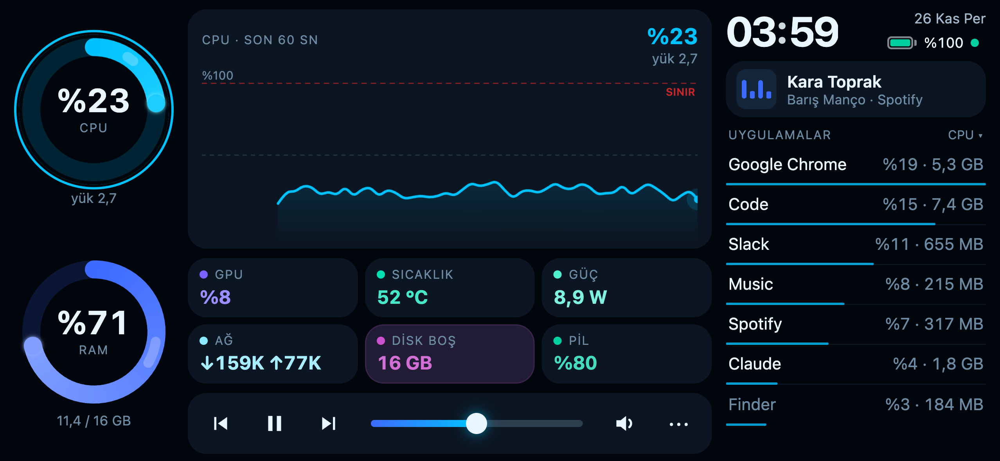

# PhoneBox

**Türkçe** · [English](#english)

Mac'inin canlı durumunu iPhone'unda gösteren bir menü çubuğu uygulaması. iPhone'u kabloyla Mac'e tak, telefonu
masanın yanına koy: CPU, RAM, GPU, sıcaklık, güç, ağ, disk, pil, en çok kaynak kullanan uygulamalar ve çalan
şarkı bir bakışta görünür. Bir değer sınırına yaklaştıkça kızarır, sınırda kalınca ekranın kenarı kırmızı yanar.

Telefona hiçbir şey kurulmaz: dashboard, Mac'teki PhoneBox'ın sunduğu bir web sayfasıdır ve Safari'de (ya da
Chrome'da) açılır. Veri iPhone takılıyken USB kablosu üzerinden gider.



## Neler var

- **Halkalar:** CPU ve RAM; RAM, macOS'un bellek baskısına göre kızarır.
- **Son 60 saniyenin grafiği:** bir halkaya ya da kutucuğa dokununca grafik o metriğe geçer.
- **Kutucuklar:** GPU, sıcaklık, Mac'in çektiği güç, ağ hızı, boş disk, pil.
- **Uygulamalar:** en çok CPU ya da bellek kullananlar. Birine dokun: kapat ya da zorla kapat.
- **Şimdi çalıyor:** önceki / oynat-duraklat / sonraki, ses seviyesi, sessiz.
- **"⋯" menüsü:** Mac'i kilitle, ekranı kapat, uyut (uyutmadan önce sorar).
- **Saat, tarih ve telefonun pili** köşede; telefon yatayken bütün değerler bir arada, dikeyken "tek bakış" düzeni.
- **Claude Code oturumları** (isteğe bağlı): panonun altındaki bir sayfada; bir oturum seni beklemeye başlayınca
  sayfa kendiliğinden gelir.
- Türkçe ve İngilizce, telefonun ve Mac'in diline göre.

## Gereksinimler

- Apple Silicon'lu (M1 ya da sonrası) bir Mac, macOS 14 ya da üstü.
- Bir iPhone ve kablosu. iPhone'un bu Mac'e "Güven" demiş olması yeterli.

## Kurulum

Terminal'i aç ve şunu yapıştır:

```bash
curl -fsSL https://raw.githubusercontent.com/cyesaa/phone-box/main/install.sh | bash
```

PhoneBox `/Applications` klasörüne kurulur (yazılamıyorsa `~/Applications`) ve açılır; menü çubuğunda bir telefon
simgesi belirir. Uygulama Apple tarafından onaylanmış (notarize) değildir; `curl` ile indirilen dosya karantinaya
alınmadığı için macOS onu engellemez.

## İlk kullanım

1. iPhone'u kabloyla Mac'e tak. İlk seferde Mac'te bir QR kodu açılır (sonra menüden "QR kodunu göster…").
2. QR kodunu iPhone'un kamerasıyla okut; dashboard tarayıcıda açılır.
3. "Başlat"a bir kez dokun: ekran açık kalır.
4. Paylaş → **Ana Ekrana Ekle**. Ana ekrandaki simgeden açınca dashboard tam ekran olur.
5. Telefonu yan çevir ve bir standa koy.

Dashboard'un "⋯" menüsündeki **Kurulum rehberi** bu adımları telefonda da gösterir. Kablo takılınca dashboard'un
kendiliğinden açılması için isteğe bağlı bir Kestirmeler otomasyonu da orada anlatılır.

## Ayarlar ve menü çubuğu

Menü çubuğundaki telefon simgesine tıkla: durum satırı ("iPhone bağlı · 1 cihaz", "Telefon Wi-Fi'de: kabloyu tak"
gibi), **Ayarlar…** (⌘,), **QR kodunu göster…**, yeni sürüm varsa **PhoneBox x.y.z sürümünü yükle…**,
**Güncellemeleri denetle…** ve **PhoneBox'tan çık**. PhoneBox zaten açıkken onu yeniden açmak (Finder, Launchpad) da
ayarlar penceresini getirir.

Ayarlar penceresi Sistem Ayarları gibidir; solda dört bölüm var:

| Bölüm | Neler var |
|---|---|
| Bağlantı | Canlı durum (kaç telefon bağlı, kablodan mı Wi-Fi'den mi). **Telefona veri gönder**: **Kablo takılıyken** (varsayılan) ya da **Her zaman**. **Wi-Fi'den kilit ve müzik**: yalnız "Her zaman"da; Wi-Fi'deki telefon da Mac'i kilitleyebilir ve müziği oynatıp duraklatabilir, değiştirebilir (varsayılan kapalı; açarken sorar). **Port** (4747): değiştirince yeni QR kodu okutulur, sayfa Ana Ekrana yeniden eklenir, eski simge silinir |
| Eşleştirme | QR kodu (başka bir telefonu eklemek için), **Bağlantıyı kopyala**, **Büyüt…**; şu an bağlı telefonlar; **Eşleştirmeyi sıfırla** (yeni anahtar: eşleşmiş bütün telefonların bağlantısı kesilir) |
| Claude Code | **Claude Code oturumlarını telefonda göster** (varsayılan kapalı; açarken sorar, aşağıya bak), hook'ların ve oturumların durumu, `~/.claude/settings.json`'u Finder'da göster |
| Genel | **Girişte başlat** (Mac açılınca PhoneBox da açılır), sürüm ve **Şimdi denetle** (aşağıya bak), GitHub sayfası ve lisanslar |

## Claude Code oturumları

Ayarlar → Claude Code'da **Claude Code oturumlarını telefonda göster**'i açarsan telefon, panonun altındaki ikinci bir sayfada Mac'te açık Claude Code
oturumlarını gösterir (masaüstü uygulaması, VS Code, terminal): her birinin başlığı, proje klasörünün adı, modeli, ne
yaptığı ve ne zamandır. Seni bekleyen oturumlar (bir soru, bir izin ya da sıra sende) turuncu parlar. Bir oturum seni
beklemeye başlayınca pano yukarı kayar ve bu sayfa gelir; kendiliğinden geldiyse, bekleyen kalmayınca 3 saniye sonra
panoya döner. Parmağını yukarı ya da aşağı kaydırarak iki sayfa arasında geçersin; sağ kenardaki iki nokta hangi
sayfada olduğunu gösterir.

- Açarken PhoneBox ne yapacağını sorar: `~/.claude/settings.json` dosyasına hook ekler ve dosyanın bir kopyasını
  `settings.json.phonebox-backup` olarak saklar. Dosyadaki diğer her şey kalır; dosya anahtarları sıralı ve iki boşluk girintiyle yeniden yazılır.
- Telefona yalnız oturum başlıkları, proje klasörlerinin adları, model ve durum gider; "Her zaman" modunda Wi-Fi'den
  de. Mesajlar, sorular, komutlar ve kod hiçbir zaman saklanmaz ve telefona gitmez.
- Kapatınca hook'lar silinir; PhoneBox'ı kaldırmak da siler.

## Güvenlik ve gizlilik

- Eşleştirme anahtarı QR kodundaki bağlantının `#` sonrasında durur ve hiçbir zaman sunucuya gönderilmez. Telefon
  her bağlantıda bu anahtarla kimliğini kanıtlar; her komut da bu anahtarla imzalanır.
- Komutlar (uygulama kapatma, medya, ses, kilitleme, uyutma) **kablodan** kabul edilir; Wi-Fi'deki bir telefon
  sadece izler. Ayarlar → Bağlantı'da **Wi-Fi'den kilit ve müzik**'i açarsan Wi-Fi'deki telefon Mac'i kilitleyebilir ve müziği
  oynatıp duraklatabilir, değiştirebilir. O zaman aynı Wi-Fi ağını ele geçiren biri de aynısını yapabilir: ekranı
  kilitler ya da şarkı atlatır. Ses, ekranı kapatma, uygulama kapatma ve uyutma yine yalnızca kablodan çalışır.
  Wi-Fi'den kilit 30 sn'de en fazla bir kez çalışır; ayarı kapatmak (ya da eşleştirmeyi sıfırlamak) kötüye kullanımı
  durdurur.
- Sayfa düz HTTP ile sunulur. "Her zaman" modunda aynı Wi-Fi'deki biri CPU değerlerini ve uygulama adlarını görebilir;
  bu yüzden varsayılan mod "sadece kablo takılıyken"dir.
- PhoneBox internete yalnızca güncellemeleri denetlemek için çıkar (GitHub, günde iki kez). Kapatmak için:
  `defaults write com.phonebox.PhoneBox CheckForUpdatesAutomatically -bool false`

## Güncelleme

PhoneBox yeni bir sürüm çıkınca menüde "PhoneBox x.y.z sürümünü yükle…" gösterir; "Güncellemeleri denetle…" (ya da
Ayarlar → Genel → "Şimdi denetle") ile elle de bakabilirsin. Yükleme PhoneBox'ı kapatır, yenisini yerine koyar ve açar; telefon kendiliğinden yeniden
bağlanır, panel yenilenir ve bir kez "Başlat" ister. Kurulum komutunu yeniden çalıştırmak da günceller.

## Kaldırma

```bash
curl -fsSL https://raw.githubusercontent.com/cyesaa/phone-box/main/install.sh | bash -s -- --uninstall
```

Uygulamayı, ayarlarını, eşleştirme anahtarını, kayıtlarını ve Claude Code hook'larını siler. Telefondaki ana ekran
simgesini elle sil.

## Sorun giderme

- **Dashboard "Kabloyu tak" diyor:** telefon Wi-Fi'den bağlı. Kabloyu tak ya da Ayarlar → Bağlantı'da "Her zaman"ı
  seç.
- **QR kodu okuttum ama sayfa açılmıyor:** iPhone ile Mac aynı ağda olmalı ya da iPhone kabloyla takılı olmalı.
  macOS PhoneBox'ın gelen bağlantıları kabul etmesini sorduysa izin ver (Sistem Ayarları → Ağ → Güvenlik Duvarı).
- **"Port 4747 kullanımda":** Ayarlar → Bağlantı → Port'ta başka bir port seç, yeni QR kodunu okut, sayfayı Ana Ekrana yeniden ekle ve eski simgeyi sil (eski simge eski portu açar).
- **Müzik, ses ya da uygulama komutları çalışmıyor:** komutlar kablodan çalışır; kablonun takılı olduğuna bak.
  Wi-Fi'de yalnız kilit ve müzik çalışabilir, o da ayarlarda "Wi-Fi'den kilit ve müzik" açıksa.
- **Ekran kararıyor:** dashboard'u açtıktan sonra "Başlat"a dokun. Olmazsa Ayarlar → Ekran ve Parlaklık → Otomatik
  Kilit'i "Asla" yap.
- **Telefonu yan çevirince sayfa dönmüyor:** iPhone'da Dikey Yön Kilidi açık. Denetim Merkezi'ni aç (sağ üst köşeden
  aşağı kaydır) ve etrafında ok olan kilit düğmesine dokunup kapat.
- **Claude Code bilinmeyen `StopFailure` hook'u için uyarı veriyor:** Claude Code'un eski bir sürümü bu olayı tanımıyor;
  diğer hook'lar çalışmaya devam eder. Claude Code'u güncelle, uyarı kalkar.

## Kaynaktan derleme

Xcode'un Komut Satırı Araçları yeterli (`xcode-select --install`).

```bash
git clone --recurse-submodules https://github.com/cyesaa/phone-box.git
cd phone-box
make app      # build/PhoneBox.app
make run      # derler ve açar
make test
```

Daha önce alt modülsüz klonladıysan: `git submodule update --init`. Tasarım ve planlar `docs/design/` altında
(Türkçe).

## Lisans

MIT, bkz. [LICENSE](LICENSE). PhoneBox, çalan şarkıyı okumak için
[mediaremote-adapter](https://github.com/ungive/mediaremote-adapter)'ı (BSD 3-Clause) içerir; bkz.
[THIRD_PARTY_NOTICES.md](THIRD_PARTY_NOTICES.md).

---

<a id="english"></a>

# PhoneBox (English)

A menu bar app that shows your Mac's live state on your iPhone. Plug the iPhone into the Mac with its cable and set
it beside the desk: CPU, RAM, GPU, temperature, power, network, disk, battery, the busiest apps and the song that is
playing, at a glance. A value turns red as it nears its limit, and the screen's edge lights up red while it stays
there.

Nothing is installed on the phone: the dashboard is a web page that PhoneBox serves from the Mac, opened in Safari
(or Chrome). While the iPhone is plugged in, the data travels over the USB cable.

## What it shows

- **Rings:** CPU and RAM; RAM turns red by macOS's memory pressure.
- **The last 60 seconds as a graph:** tap a ring or a tile to graph that metric.
- **Tiles:** GPU, temperature, the Mac's power draw, network speed, free disk, battery.
- **Apps:** the ones using the most CPU or memory. Tap one to quit or force quit it.
- **Now playing:** previous / play-pause / next, volume, mute.
- **The "⋯" menu:** lock the Mac, turn its display off, put it to sleep (it asks first).
- **Clock, date and the phone's own battery** in the corner; everything at once in landscape, a single-glance layout
  in portrait.
- **Claude Code sessions** (optional): on a page below the dashboard, which comes up by itself when a session starts
  waiting for you.
- English and Turkish, following the phone's and the Mac's language.

## Requirements

- A Mac with Apple silicon (M1 or later), macOS 14 or later.
- An iPhone and its cable. The iPhone only has to trust this Mac.

## Install

Open Terminal and paste:

```bash
curl -fsSL https://raw.githubusercontent.com/cyesaa/phone-box/main/install.sh | bash
```

PhoneBox is installed in `/Applications` (or `~/Applications` when that is not writable) and opened; a phone icon
appears in the menu bar. The app is not notarized by Apple; files downloaded with `curl` are not quarantined, so macOS
does not block it.

## First run

1. Plug the iPhone into the Mac. The first time, a QR code opens on the Mac (later: "Show QR Code…" in the menu).
2. Scan it with the iPhone's camera; the dashboard opens in the browser.
3. Tap "Start" once: the screen stays on.
4. Share → **Add to Home Screen**. Opened from the Home Screen icon, the dashboard is full screen.
5. Turn the phone sideways and put it on a stand.

**Setup guide** in the dashboard's "⋯" menu shows these steps on the phone, along with an optional Shortcuts
automation that opens the dashboard when the cable is plugged in.

## Settings and the menu bar

Click the phone icon in the menu bar: a status line (e.g. "iPhone connected · 1", "Phone on Wi-Fi: plug in the
cable"), **Settings…** (⌘,), **Show QR Code…**, **Install PhoneBox x.y.z…** when there is a new version, **Check for
Updates…** and **Quit PhoneBox**. Opening PhoneBox again while it runs (Finder, Launchpad) also brings up the settings
window.

The settings window works like System Settings, with four sections on the left:

| Section | What is in it |
|---|---|
| Connection | The live status (how many phones, over the cable or Wi-Fi). **Send data to the phone**: **While Plugged In** (default) or **Always**. **Lock and music over Wi-Fi**: only with "Always"; a phone on Wi-Fi can also lock the Mac and play, pause or skip music (off by default; asks first). **Port** (4747): after a change scan the new QR code, add the page to the Home Screen again and delete the old icon |
| Pairing | The QR code (to add another phone), **Copy Link**, **Show Larger…**; the phones connected now; **Reset pairing** (a new key: every paired phone is disconnected) |
| Claude Code | **Show Claude Code sessions on the phone** (off by default; asks first, see below), the state of the hooks and sessions, `~/.claude/settings.json` in Finder |
| General | **Open at Login** (PhoneBox starts with the Mac), the version and **Check Now** (see below), the GitHub page and the licenses |

## Claude Code sessions

Turn on **Show Claude Code sessions on the phone** in Settings → Claude Code and the phone shows the Mac's open Claude Code sessions (desktop app,
VS Code, terminal) on a second page below the dashboard: each one's title, project folder, model, what it is doing and
for how long. Sessions waiting for you (a question, a permission, or your turn) glow orange. When a session starts
waiting for you, the dashboard slides up and this page comes in; if it came by itself, it goes back 3 seconds after
nothing is waiting any more. Swipe up or down to switch pages; two dots on the right edge show which page you are on.

- Turning it on asks first: PhoneBox adds hooks to `~/.claude/settings.json` and keeps a copy of the file as
  `settings.json.phonebox-backup`. Everything else in the file stays; the file is rewritten with sorted keys and two-space indentation.
- Only session titles, project folder names, the model and the state go to the phone, in "Always" mode over Wi-Fi
  too. Messages, questions, commands and code are never stored and never go to the phone.
- Turning it off removes the hooks; so does uninstalling PhoneBox.

## Security and privacy

- The pairing key sits after the `#` of the QR code's link and is never sent to a server. The phone proves itself with
  it on every connection, and every command is signed with it.
- Commands (quitting apps, media, volume, lock, sleep) are accepted **over the cable**; a phone on Wi-Fi only
  watches, unless you turn on **Lock and music over Wi-Fi** in Settings → Connection: then it can also lock the Mac and play, pause
  or skip music. So could someone who takes over the same Wi-Fi network: lock the screen or skip a song. Volume,
  display off, quitting apps and sleep still work only over the cable. A lock over Wi-Fi works at most once every
  30 seconds, and turning the setting off (or resetting the pairing) stops anyone misusing it.
- The page is served over plain HTTP. In "Always" mode someone on the same Wi-Fi could see the CPU figures and app
  names, which is why the default is "only while the cable is plugged in".
- PhoneBox goes online only to check for updates (GitHub, twice a day). To turn that off:
  `defaults write com.phonebox.PhoneBox CheckForUpdatesAutomatically -bool false`

## Updating

When a new version is out, the menu shows "Install PhoneBox x.y.z…"; "Check for Updates…" (or Settings → General →
"Check Now") looks right away. Installing
quits PhoneBox, puts the new version in place and opens it; the phone reconnects by itself, the dashboard reloads and asks for "Start" once. Running the install
command again updates too.

## Uninstall

```bash
curl -fsSL https://raw.githubusercontent.com/cyesaa/phone-box/main/install.sh | bash -s -- --uninstall
```

This removes the app, its settings, the pairing key, its logs and its Claude Code hooks. Delete the Home Screen icon
on the phone by hand.

## Troubleshooting

- **The dashboard says "Plug in the cable":** the phone is connected over Wi-Fi. Plug in the cable, or choose
  "Always" in Settings → Connection.
- **The QR code opens nothing:** the iPhone has to be on the Mac's network or plugged into it. If macOS asked whether
  PhoneBox may accept incoming connections, allow it (System Settings → Network → Firewall).
- **"Port 4747 is in use":** choose another port in Settings → Connection → Port, scan the new QR code, add the page to the Home Screen again and delete the old icon (the old one opens the old port).
- **Music, volume or app commands do nothing:** commands work over the cable; check that it is plugged in. On Wi-Fi
  only lock and music can work, and only with "Lock and music over Wi-Fi" on in the settings.
- **The screen goes dark:** tap "Start" after opening the dashboard. If it still does, set Settings → Display &
  Brightness → Auto-Lock to "Never".
- **The page doesn't turn when you turn the phone sideways:** Portrait Orientation Lock is on. Open Control Center
  (swipe down from the top-right corner) and tap the lock with the circular arrow to turn it off.
- **Claude Code warns about an unknown `StopFailure` hook:** an older Claude Code does not know this event; the other
  hooks keep working. Update Claude Code and the warning goes away.

## Building from source

The Xcode Command Line Tools are enough (`xcode-select --install`).

```bash
git clone --recurse-submodules https://github.com/cyesaa/phone-box.git
cd phone-box
make app      # build/PhoneBox.app
make run      # builds and opens it
make test
```

If you cloned without submodules: `git submodule update --init`. The design and plans are in `docs/design/`
(in Turkish).

## License

MIT, see [LICENSE](LICENSE). PhoneBox includes [mediaremote-adapter](https://github.com/ungive/mediaremote-adapter)
(BSD 3-Clause) to read what is playing; see [THIRD_PARTY_NOTICES.md](THIRD_PARTY_NOTICES.md).
